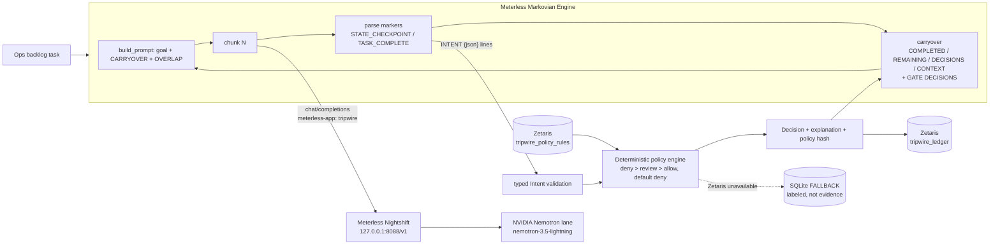

# Tripwire: a governance gate for AI agents

**Open Agent Hackathon 2026 (GenAI.works / HackOS), track: Reasoning Architecture**

Agents should not hold the keys. In Tripwire, an agent can only **propose typed intents**
(`issue_refund`, `export_data`, `pay_vendor`, ...). A **deterministic policy gate** evaluates
each intent against rules stored in **Zetaris** and returns an explainable
**ALLOW / REVIEW / DENY** with the exact rule IDs that fired. Every decision is appended to an
agent-action ledger in Zetaris. The model never decides policy; it only proposes.

The agent itself runs on **NVIDIA Nemotron through Meterless Nightshift**, and its long backlog
job is executed with the **Meterless Markovian Engine**: bounded chunks, flat context, and the
gate's decisions folded into the carryover so the agent adapts (e.g. replaces a denied PII export
with an aggregate export) without replaying its history.

## Architecture



## How each required layer is used

| Layer | Requirement | Where in the code |
|---|---|---|
| **Data: Zetaris** | Policy rules and the agent-action ledger are Zetaris tables, read/written with Lightning SQL over the REST API from the setup guide (`POST {ZETARIS_REST_URL}/sql-editor/sqls/run`, `Bearer` API key, `X-Org-ID`, fresh UUID `X-Request-ID`, one statement per request). | `tripwire/store.py` (`ZetarisStore`) |
| **Power: Meterless** | Primary AI provider. OpenAI-compatible, `GET /v1/models` discovery, `POST /v1/chat/completions`, `Authorization: Bearer $METERLESS_RUNTIME_TOKEN` (env only), `meterless-app: tripwire`, `meterless-scope: user`, routing mode `meterless/auto` (override with `METERLESS_MODEL` / `--model`). 401/403 is reported as *unauthorized*, not offline. Every call records a **receipt** with the `routed_model`. | `tripwire/meterless.py` |
| **NVIDIA Nemotron** | The agent that proposes intents is served by a Nemotron lane in Nightshift; receipts show `routed_model` and `is_nemotron`. | `docs/evidence/receipts-*.json` |
| **Build: Meterless Engine** | **Markovian** (long tasks, flat context). Python port of `engines/markovian/AGENTS.md`: `ChunkConfig` with bounds + typed errors, marker protocol, canonical carryover block, `[OVERLAP]`, per-run config snapshot, efficiency math, token labels, reflection that can't fail the run. Used in the live feature: the agent's backlog run. | `tripwire/markovian.py`, `tripwire/gate.py` |
| **Build: Cursor** | Built in Cursor. | this repo |

### Why Markovian fits Reasoning Architecture
A governance gate turns an agent's job into many small decide-then-continue steps. Replaying the
whole transcript each step makes context grow quadratically and lets earlier denied attempts leak
back in. Markovian keeps each step to *goal + structured state + latest gate verdicts*. The
verdicts become part of the agent's state (`GATE DECISIONS:`), so reasoning is shaped by policy,
while policy stays outside the model.

### Engine verification
`tests/test_markovian_conformance.py` is a check-for-check Python port of the official
`engines/markovian/conformance/runner.ts` (eff-001, snap-001, snap-002, ovl-001, lab-001, ref-001,
mrk-001, cfg-001) plus a flat-context test. (The official runner loads a TypeScript module, so it
can't import this Python implementation directly; the assertions are identical.)

## Policy (seeded into Zetaris by the first run)

| Rule | Action | Effect | Condition |
|---|---|---|---|
| R01/R02 | read_record | allow / review | review for pii, regulated |
| R03/R04 | export_data | allow / **deny** | deny for pii, regulated, confidential |
| R05/R06 | send_email | allow / review | review outside `@acme.example` |
| R07/R08 | issue_refund | allow / review | review over $200 |
| R09/R10 | pay_vendor | review / **deny** | deny at $10,000+ |
| R11 | change_permissions | **deny** | always |
| R12 | delete_record | review | always |
| R13 | run_sql | allow | public/internal only |

Anything no rule allows is **denied by default**. Decisions carry a policy hash, so a ledger row
can be tied to the exact rule set that produced it.

## Setup

Requirements: Python 3.10+ (standard library only), Meterless Nightshift running with an NVIDIA
Nemotron lane, and Zetaris (local Docker install or a Zetaris Cloud cluster).

```bash
git clone https://github.com/icohangar-ops/tripwire-gate && cd tripwire-gate
cp .env.example .env        # fill in values; .env is gitignored
./run.sh                    # tests -> connection check -> live demo, evidence into docs/evidence/
```

Other commands:

```bash
python3 -m tripwire check                       # Meterless (models + a chat + routed model) and Zetaris SELECT 1
python3 -m tripwire demo --evidence docs/evidence
python3 -m tripwire demo --offline              # scripted agent, no model: for CI only, NOT evidence
python3 -m tripwire decide '{"agent_id":"ops-agent","action":"pay_vendor","resource":"inv:1","amount":12500}'
python3 -m tripwire ledger
python3 -m unittest discover -s tests
```

`METERLESS_RUNTIME_TOKEN` must be in the environment or `.env`. It is never hardcoded or logged.

### Fallback
If Zetaris is not configured or not reachable, Tripwire prints a WARNING and uses a local SQLite
file (`backend=sqlite-fallback`). This exists only so the demo can run; fallback ledgers are
labeled as such and are not Zetaris evidence.

## Evidence
See [`docs/evidence/`](docs/evidence/README.md) for console logs, Meterless receipts and ledgers
from real runs.

## Repo layout
```
tripwire/intents.py    typed intents + INTENT line extraction
tripwire/policy.py     deterministic rule engine + seed policy
tripwire/store.py      Zetaris store (primary) + SQLite (fallback only)
tripwire/meterless.py  Meterless Runtime provider + receipts
tripwire/markovian.py  Meterless Markovian Engine
tripwire/gate.py       agent loop: Markovian chunks -> gate -> ledger -> carryover
tripwire/scenario.py   demo task (+ scripted offline generator)
tests/                 conformance port, policy, provider + Zetaris contract tests (mock servers)
run.sh                 one-command run with evidence capture
```

License: MIT
